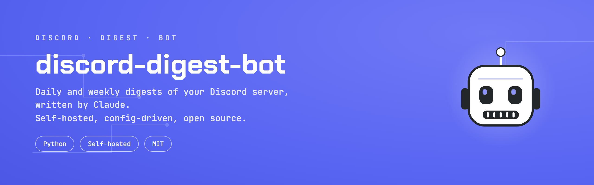

# discord-digest-bot



Your Discord server, summarized. A small bot that reads what your community talked about and posts a short summary back into the server, every day and every week.

## What it is

Discord is where a lot of communities live now, and a busy server moves fast. Dozens of channels, hundreds of messages a day, and nobody can keep up with all of it. Good conversations scroll away. Someone steps out for the weekend, comes back to a wall of backlog, and just gives up on catching up.

This bot fixes that. It sits in your server, reads the recent messages in the channels you pick, and uses Claude to write a short, readable recap of what actually happened. Then it posts that recap right back into a channel, so anyone can catch up in a minute. That recap is what I call the "digest."

It runs two ways. A daily digest covers the last day. A weekly digest covers the last week. You choose which channels it reads and which channel it posts to.

You host it yourself. You bring your own Discord bot and your own Claude API key, put them in a config file, and set it on a schedule. It's open source and free under the MIT license.

### Sample digest

This sample is invented. The names and channels are made up.

```
Daily Digest, Tue Oct 13

Over in #showcase, Marisol shared a small script that renames photo files by the date they were taken. Two people asked for a Windows version, and she posted one an hour later.

In #help, Theo's bot could not see a private channel. Priya pointed out that the bot's role needs View Channel on that channel too, and that fixed it.

Four new members said hello in #introductions. Welcome, everyone!
```

## Why it exists

I built this for a Discord server I started. We got active enough that people kept falling behind, and anyone who stepped away for a few days had no easy way back in. I wanted one short post a day that said "here's what you missed," written well enough that people would actually read it.

Claude turned out to be great at this. It reads the raw chatter and writes a recap that sounds like a real person caught you up over coffee. So I cleaned the tool up, pulled everything specific to my server out into a config file, and put it here so you can run the same thing on yours.

If you run a community and you want to keep people in the loop without anyone scrolling back through a thousand messages, this is for you.

## How it works

The bot runs on a schedule. On each run it reads a window of recent messages from a configured list of channels via the Discord REST API, hands those messages to an LLM to write a readable digest, validates the result, and then either posts the digest to a target channel or writes it to a local file for review. There are two periods, `weekly` and `daily`, that share one engine and are selected with `--period`. Every server-specific value lives in a JSON config file; nothing about any particular server is hardcoded.

The `weekly` period reads a rolling window (default the last 7 days). The `daily` period reads an anchored window that snaps to a fixed clock hour (default 23:00 local), so "today" always means the same span, and it skips genuinely quiet days below a message threshold.

For each channel it reads the whole window. Discord hands back at most 100 messages per request, so the bot pages backward through a channel until it passes the start of the window or hits a safety ceiling of `max_fetch_per_channel` messages per channel per run (default 1000). On a very busy channel that means it reads up to that many messages, and if it hits the ceiling before covering the whole window it writes a clear TRUNCATED line to `./logs` naming the channel, so a busy channel never drops older messages in silence. Raise `max_fetch_per_channel` if you see that line and want the full window read.

Each run goes through these steps:

1. **Duplicate check.** The bot reads its own last 50 posts in the digest channel. If this period's digest is already there, the run logs a skip line and stops. So a rerun, or a retry after the second of two messages failed, never posts the same digest twice.
2. **Read.** It reads each channel in `read_channels`. With `read_threads` on (the default), it also reads the active threads under those channels. Thread messages join their parent channel's list and are labeled with the thread name. A channel name it cannot find is logged as a WARNING, and the run continues with the rest.
3. **Carryover and quiet days.** On an anchored period with `carryover` on, the bot reads back to its own last digest post, at most `max_carry_days` days. Messages from days that were skipped as quiet are marked as earlier, and the writer reports them in a short "Since the last digest" section. Today's and carried messages count together toward `min_messages`. Only messages with text count. After `max_quiet_runs` skipped runs in a row, any message at all is enough to post.
4. **Link context (optional, off by default).** With `link_context.enabled`, the bot fetches the links members posted and gives the writer a short title and summary for each one. See Safety below.
5. **Write.** The writer gets your `digest_instructions` plus a set of engine rules: treat member messages as data, start with the exact header line, how long to aim for, and how to name people and channels.
6. **Trim, then split.** If the draft is slightly over one Discord message (at most `trim_max_over` characters over), the writer gets one chance to shorten it. If it is still too long, the bot splits it at the paragraph break nearest the middle, never right after the title line.
7. **Validate.** A draft is rejected if the first line is not the header, if text comes before the header, if it has a code fence, if a line opens like a refusal ("I can't", "As an AI"), if a later message is under `min_part_chars`, or if it is too short, too long, or in too many parts.
8. **Secret scan, then post.** The digest is scanned for credentials. Then it is posted, or written to `./out` on a dry run.

## What data goes where

- **To the writer.** The text of members' messages in the window goes to the writer you configure. That is Anthropic's API, or the Claude Code CLI on your machine, which sends it on to the model service it is set up to use. Each message goes with its author's display name and user ID, its time, its reaction count, and its thread name if it has one.
- **Kept on disk.** A copy of each run's message JSON is saved in `./digest_work/`. The newest eight files are kept, and older ones are deleted at the start of each run. Logs go to `./logs`, and dry-run digests go to `./out`.
- **Dropped.** Messages from bots are dropped before anything is sent. Attachments and embeds are not sent; only the message text is.
- **Outbound requests.** The bot calls the Discord API. When link context is on, it also makes requests from your machine to the linked sites and to `api.github.com`, and the fetched summaries go to the writer too.

## Prerequisites

- Python 3.10 or newer.
- A Discord bot and token (see below).
- An LLM credential: either an Anthropic API key (default) or the Claude Code CLI installed on the machine (alternative). See "LLM writer" below.
- For the default writer, the `anthropic` Python package: `pip install -r requirements.txt`.

## Create a Discord bot and get a token

1. Go to the Discord Developer Portal at https://discord.com/developers/applications and click **New Application**. Name it and create it.
2. In the left sidebar open **Bot**. Under the bot's settings, click **Reset Token** (or **Add Bot** on older UIs) and copy the token. This token is a secret. Treat it like a password. It is the only time Discord shows it in full, so store it now.
3. Still on the **Bot** page, scroll to **Privileged Gateway Intents** and turn on **Message Content Intent**. The bot reads message text, so this intent is required. Save.
4. Invite the bot to your server. In the left sidebar open **OAuth2 > URL Generator**. Under **Scopes** check **bot**. Under **Bot Permissions** check the permissions listed in the next section. Copy the generated URL at the bottom, open it in a browser, pick your server, and authorize.
5. Make sure the bot's role can actually see the read channels and the digest channel. Channel-level permission overrides can hide a channel from the bot even when the server-wide permission is granted, so check each channel's permissions if a channel comes up empty.

### Exact bot permissions

The bot needs only these three permissions:

- View Channels, so it can read the channels it summarizes and see the digest channel.
- Read Message History, so it can fetch the recent messages in each channel. It needs this in the digest channel too, because the duplicate check and carryover read the bot's own recent posts there.
- Send Messages, so it can post the digest (needed only when `armed` is `true`).

It doesn't need any moderation or management permissions, and you shouldn't grant it any. See the Limitations section.

Do not grant Mention Everyone. The bot already blocks @everyone, @here and role pings in what it posts, and leaving that permission off is a second layer.

## Store the token

Provide the token in one of two ways. The bot checks them in this order:

1. The `DISCORD_BOT_TOKEN` environment variable.
2. A file whose path is set by `discord.token_file` in your config. The code has no default path. `config.example.json` sets it to `./secrets/discord_token.txt`, so a config copied from the example uses that file. If `token_file` is missing from your config, only the environment variable is checked. Blank lines and lines starting with `#` are ignored, so the first non-comment line is read as the token.

The `secrets/` folder, `discord_token.txt`, and `config.json` are all listed in `.gitignore`, so a real token never lands in the repo. Never paste a token into `config.json` or `config.example.json`.

## LLM writer

The bot needs an LLM to turn raw messages into prose. Two backends are supported, chosen by `writer.backend` in config.

- **`anthropic` (default).** Uses the official `anthropic` Python SDK and calls the Anthropic API directly. Set the `ANTHROPIC_API_KEY` environment variable and install the package with `pip install -r requirements.txt`. Set the model in `writer.model`. The bot passes no tools to the model. If the reply stops because it ran out of tokens, or the model refuses, the run fails and nothing posts.
- **`claude_cli` (alternative).** Runs the Claude Code CLI already installed on the machine. Set `writer.backend` to `claude_cli` and, if the CLI is not on `PATH`, set `writer.claude_cli_path` to its full path. The model is still taken from `writer.model`, and the CLI also accepts aliases such as `opus`. No Python package is needed for this path. The prompt goes in on standard input. The CLI runs with every tool turned off, in an empty folder, `./digest_work/writer_sandbox`, which is cleared before each run. See Safety below for the exact flags.

Either way, the model id is a config value. Nothing is hardcoded, so you pick the model and can change it without touching code.

**Which model.** The example config uses `claude-opus-5-5`. Smaller models were tried in production and added details that were not in the messages. In a digest, a made-up claim appears under a real member's name, so this bot favors the more careful model. You can set a smaller model to save on usage. If you do, read several dry runs first and check for added details.

**max_tokens.** Recent Claude models think before they answer, and that thinking counts toward `writer.max_tokens`. With `claude-opus-5-5` the thinking cannot be turned off. The example sets `max_tokens` to 16000 so the digest has room after the thinking. If a run fails with a message about `max_tokens`, raise it.

## Setup

1. Clone or download this repo.
2. Install dependencies (for the default Anthropic writer): `pip install -r requirements.txt`.
3. Copy `config.example.json` to `config.json` and fill in your values (see the config reference below).
4. Put your Discord bot token in `./secrets/discord_token.txt` or set the `DISCORD_BOT_TOKEN` environment variable.
5. For the default writer, set the `ANTHROPIC_API_KEY` environment variable.
6. Do a dry run with `armed` left at `false`: `python digest_bot.py --period weekly`. Read the file it writes under `./out`.
7. When the output looks right, set the period's `armed` to `true` in `config.json` and schedule it (see below).

### Command-line options

- `--period NAME`: which block under `periods` to run. Default `weekly`.
- `--config PATH`: the config file to use. Default `config.json` in the repo folder. This lets you keep one config per server, for example `python digest_bot.py --period daily --config configs/second-server.json`.

## Config reference

Copy `config.example.json` to `config.json`. All values are placeholders in the example; replace them. Every key added since the first release has a default in code, so an older `config.json` still loads.

`discord`
- `guild_id`: your server's ID (enable Developer Mode in Discord, right-click the server, Copy Server ID).
- `token_file`: path to the token file. Relative paths resolve against the repo folder. Ignored if `DISCORD_BOT_TOKEN` is set. There is no default in code; the example sets `./secrets/discord_token.txt`.
- `read_channels`: list of channel names (not IDs) to read and summarize. These must be text channels. With `read_threads` on, the bot also reads their active threads. A name it cannot find is logged as a WARNING and skipped.
- `read_threads`: `true` (default) reads the active threads under each read channel. `false` reads the channels only.

`writer`
- `backend`: `anthropic` (default) or `claude_cli`.
- `model`: the model id to write with. Set this; there is no default. The example uses `claude-opus-5-5`.
- `max_tokens`: maximum tokens the writer may produce, thinking included (Anthropic backend). Default 16000.
- `effort`: optional. When set, it is sent to the Anthropic API as the effort level. Leave it out to use the model's default.
- `timeout_seconds`: how long the Claude Code CLI may run before the run fails. Default 600.
- `claude_cli_path`: path to the Claude Code CLI (only for the `claude_cli` backend). Default `claude` (found on `PATH`).

`limits`
- `max_pings`: cap on how many distinct users one digest will @-mention. Beyond the cap, further users appear as plain names. Default 6.
- `message_char_limit`: hard per-message character ceiling (Discord's limit is 2000). A part over this fails the run.
- `max_messages`: the most messages one digest may split into. Default 2. At 1, the bot never splits.
- `min_digest_chars`: a digest shorter than this is treated as broken and does not post. Default 200. A period can set its own value.
- `max_fetch_per_channel`: ceiling on how many messages to pull per channel per run while paging through the window. Default 1000. If a channel hits this cap before the pager reaches the start of the window, the run logs a TRUNCATED line under `./logs` naming the channel and reads no further in it. Raise this to read more of a very busy channel.
- `target_chars`: the length the writer is asked to aim for per message on a busy day. Default 1600, which leaves room for mentions.
- `trim_max_over`: a draft up to this many characters over `message_char_limit` gets one trim pass before the split. Default 200. Set 0 to turn the trim pass off.
- `min_part_chars`: a second or later message shorter than this fails the run. Default 40.

`link_context`
- `enabled`: `false` (default) fetches nothing. `true` fetches posted links for context.
- `max_links`: most links fetched per run, first seen first. Default 8.
- `timeout_seconds`: per request. Default 10.
- `max_bytes`: most bytes read from any one response. Default 200000.
- `summary_chars`: cap on each link's summary. Default 2500.

`periods` (a block per period, e.g. `weekly` and `daily`)
- `digest_channel_id`: the channel ID the digest posts to.
- `armed`: `false` writes a dry-run file to `./out` and posts nothing; `true` posts to the digest channel. This is the on/off switch.
- `window_days`: length of the read window in days.
- `anchored`: `false` for a rolling window ending now; `true` for a window that snaps to `anchor_hour`.
- `anchor_hour`: the local hour (0 to 23) the anchored window snaps to.
- `anchor_grace_minutes`: if the next anchor hour is at most this many minutes away, the window ends there instead. Default 30. See Scheduling.
- `min_messages`: below this many messages the run skips and posts nothing. Set 0 to never skip. Only messages with text count.
- `min_digest_chars`: this period's minimum digest length. Falls back to `limits.min_digest_chars`. The example weekly uses 40, so a short quiet-week note can post.
- `carryover`: `true` reads back to the bot's last digest so skipped quiet days are reported. Defaults to the value of `anchored`.
- `max_carry_days`: the furthest back carryover reads. Default 7.
- `max_quiet_runs`: after this many skipped runs in a row, any message at all posts. Default 3. Set 0 to turn this off.
- `resolve_mentions`: `true` enables the `{{name}}` and `{{#channel}}` token system so the digest can safely @-mention people and link channels. `false` turns all pings off.
- `tag_all_named`: `false` (default) asks the writer to tag only the people a highlight is about. `true` asks it to tag everyone it names. `max_pings` still caps the pings; if you turn this on, consider raising `max_pings` to about 12.
- `header`: the exact first line of every digest. `{date}` becomes the run's day, like `Tue Oct 13`. `{range}` becomes the window's days, like `Oct 7-13` or `Sep 30-Oct 6`. An empty string means no header. If this key is missing, a period with `resolve_mentions` on uses `Daily Digest, {date}`, and other periods use no header. The header is checked on every draft, so keep your `digest_instructions` from asking for a different first line.
- `channel_name`: display name of the digest channel, used only in dry-run text.
- `digest_instructions`: the prompt that tells the LLM how to write the digest. Edit this to change the digest's voice and shape. The engine adds its own rules after it (header, length, split marker, mentions, carryover), so you don't need to repeat those.

## Scheduling

Run one command per period on whatever cadence you want.

An anchored window ends at the most recent `anchor_hour` before the run starts. If the run starts up to `anchor_grace_minutes` early, the window ends at the coming anchor hour instead, so a run at 22:45 still covers the day ending at 23:00. A run that starts late, for example when the machine wakes at 07:00, covers the day it missed and uses that day's date. Earlier versions always ended the window at today's anchor hour, even when the run started before it. Schedule the daily run a few minutes after `anchor_hour`.

### Windows Task Scheduler

Create a task that runs, for example nightly for the daily digest. These commands are for Command Prompt, where `^` continues a line:

```
schtasks /Create /F /TN "DiscordDigestDaily" ^
  /TR "\"C:\Path\To\python.exe\" \"C:\Path\To\discord-digest-bot\digest_bot.py\" --period daily" ^
  /SC DAILY /ST 23:05
```

And weekly, for example Fridays at 18:00:

```
schtasks /Create /F /TN "DiscordDigestWeekly" ^
  /TR "\"C:\Path\To\python.exe\" \"C:\Path\To\discord-digest-bot\digest_bot.py\" --period weekly" ^
  /SC WEEKLY /D FRI /ST 18:00
```

Set the environment variables (`ANTHROPIC_API_KEY`, and `DISCORD_BOT_TOKEN` if you use it) as system or user environment variables so the scheduled task can see them, or use the token file instead of the env var.

### cron (Linux / macOS)

Edit your crontab with `crontab -e` and add lines like:

```
# Daily digest at 23:05
5 23 * * * cd /path/to/discord-digest-bot && /usr/bin/python3 digest_bot.py --period daily >> logs/cron.log 2>&1

# Weekly digest Fridays at 18:00
0 18 * * 5 cd /path/to/discord-digest-bot && /usr/bin/python3 digest_bot.py --period weekly >> logs/cron.log 2>&1
```

cron runs with a minimal environment, so either export the credentials in the crontab or rely on the token file and an `ANTHROPIC_API_KEY` set in a profile the cron job sources.

## Dry-run and failure behavior

- Dry run (`armed: false`): the bot generates and validates the digest but posts nothing. It writes the exact text that would have posted to a file under `./out`, so you can preview before going live. The duplicate check runs only when armed. Carryover only reaches back to a digest the bot really posted, so dry runs alone never exercise it.
- Quiet day: if a period reads fewer than `min_messages` messages with text (carried messages included), the run logs a skip line under `./logs` and posts nothing. This is expected.
- Already posted: if this period's digest is already in the channel, the run logs `skipped, already posted` and exits normally.
- Failure rule: a broken or invalid digest never posts. The run records one FAILED line under `./logs` and exits nonzero without posting. The full error goes to standard error. A run fails when the writer fails, returns empty, runs out of tokens, or refuses; when the draft is too short, splits into too many messages, or has a part over the character limit; when it fails the shape checks in "How it works"; or when the secret scan finds a credential. Partial success on posting (one of two messages sent, then an error) is reported in the log line.
- Warnings: a missing read channel, a failed thread lookup, a failed read of the bot's own posts, or a link-context problem logs a WARNING line, and the run continues.
- Logs: every run appends its lines to `./logs/<period>_digest.log`. A success line gives the message count, the length, the day the digest covers, and how many carried messages it included.

## Safety

- **Ping containment.** Before validation, every digest has @everyone and @here neutralized, role pings removed, and any user ping for someone outside this run's messages removed. Each post also sends Discord an explicit list of the users it may ping. With `resolve_mentions` off, that list is empty, so nobody is pinged. When two members share a display name, neither is pinged.
- **Secret scan.** Before anything posts or a dry-run file is written, the digest is checked for the bot token, the `ANTHROPIC_API_KEY` value, and common key formats (Discord bot tokens, Anthropic, GitHub, Slack, AWS and Google keys, and private key blocks). A match fails the run. The error names the kind of match and never the text itself.
- **Writer sandbox.** The API backend passes no tools. The CLI backend runs `claude -p --tools "" --strict-mcp-config --restricted --permission-prompts none --no-session-persistence --disable-slash-commands`, plus `--model` when set. That turns off every built-in tool, ignores MCP servers and the user, project and local settings files, denies anything that would ask for permission, and saves no session. It runs in the empty `writer_sandbox` folder, away from `config.json` and the token file. These flags were checked against Claude Code 2.1.300. Older CLI versions may not know them; the CLI then exits with an error and the run fails without posting.
- **Prompt injection.** Members can write anything, including text aimed at the writer. The engine tells the writer that messages and link summaries are data and that instructions inside them must not be followed. This lowers the risk without removing it. Read dry runs, and keep `armed` off until the output looks right.
- **Link context.** When on, your machine requests every posted link, up to `max_links`, so the linked sites see your machine's IP address. Before each request and each redirect, the bot checks that the host resolves only to public addresses and that the URL uses http or https on port 80 or 443. It follows at most 3 redirects, sends no cookies or credentials, ignores proxy settings, and stops fetching after about 60 seconds per run. One risk remains: the check looks up the host name, and the request looks it up again. A hostile DNS server could give a public address the first time and a private one the second (DNS rebinding). Leave link context off if that matters on your machine. GitHub limits API calls made without a login; past the limit, GitHub links get no context.

## Upgrading

Your existing `config.json` keeps working, because every new key has a default. A few behaviors change:

- Anchored windows now end at the most recent anchor hour before the run, with a grace window (see Scheduling).
- Anchored periods carry over skipped quiet days unless you set `carryover` to `false`.
- Active threads are read unless you set `read_threads` to `false`.
- A period with `resolve_mentions` on now checks that every draft starts with `Daily Digest, {date}`, unless you set `header`.
- When the key is missing, `writer.max_tokens` now defaults to 16000.
- An armed run skips a period this bot already posted.

The example `digest_instructions` also gained rules that keep digests plain and accurate. Copy those sentences into your own `digest_instructions`. You can delete any sentence of yours about the split marker or about mentions, since the engine now supplies those rules.

## Limitations

This bot only reads channels and posts summaries. Two things it deliberately does not do:

- It doesn't moderate. No warnings, no timeouts, no kicking, banning, or deleting messages. It has no moderation features, and it isn't granted moderation permissions.
- It doesn't send direct-message alerts to you or to anyone else. It posts the digest, and only to the channel you set.

If you want moderation or private alerts, you'll have to build them yourself. This tool is read-and-summarize by design, and anyone is free to build on top of it.

A few other limits:

- Archived threads and forum channels are not read.
- The refusal check only knows English phrases.
- The duplicate check and carryover look at the bot's last 50 posts in the digest channel.

## License

MIT. See `LICENSE`.
